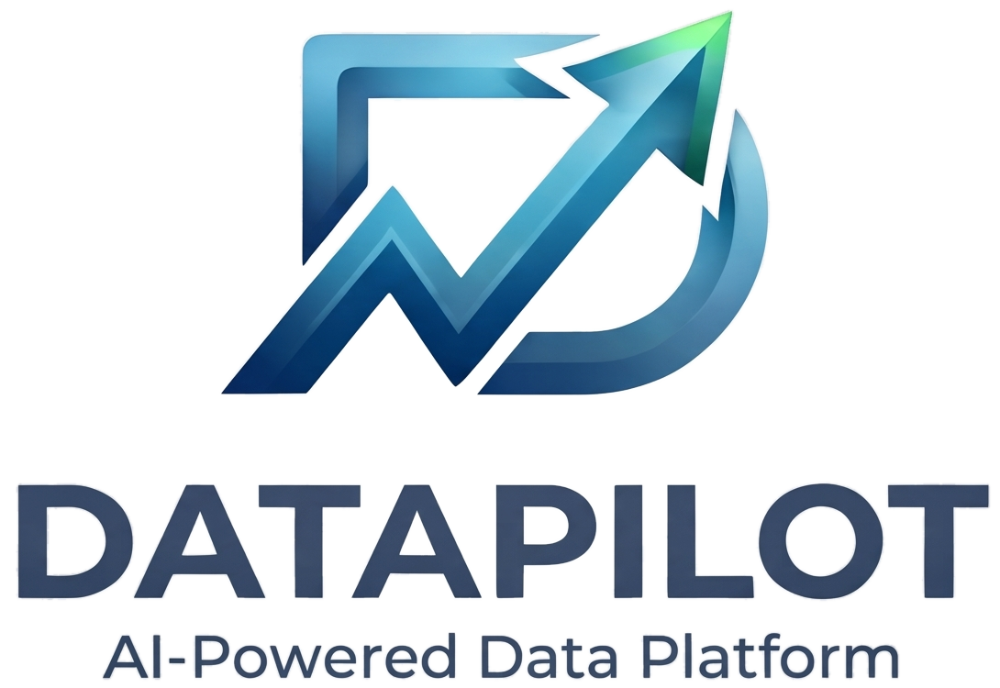

<p align="center">
  
</p>

# DataPilot — AI-Powered Data Entry, Cleaning & Analytics Platform

[](https://www.python.org/)
[](https://www.djangoproject.com/)
[](https://reactjs.org/)
[](https://tailwindcss.com/)
[-black.svg)](https://ollama.com/)

**DataPilot** is a full-stack, enterprise-ready data management, automated cleaning, exploratory data analysis (EDA), and AI-driven intelligence platform. It merges lightning-fast deterministic Pandas data transformations with open-ended natural language data copilot workflows—powered either 100% locally with private open-source LLMs (Ollama + Qwen 3.5) or via cloud AI providers (Anthropic Claude, OpenAI GPT, Google Gemini).

---

## Table of Contents

- [Core Features](#core-features)
  - [1. Data Ingestion & Exploration](#1-data-ingestion--exploration)
  - [2. Quick Actions: Cleaning & Transformation](#2-quick-actions-cleaning--transformation)
  - [3. Feature Engineering & ML Toolkit](#3-feature-engineering--ml-toolkit)
  - [4. Visual Analytics & Statistical Modeling](#4-visual-analytics--statistical-modeling)
  - [5. AI Copilot & Executive Intelligence](#5-ai-copilot--executive-intelligence)
  - [6. Smart Export Engine (CSV & Excel with Native Charts)](#6-smart-export-engine-csv--excel-with-native-charts)
  - [7. Multi-Tenancy, Security & Audit Logs](#7-multi-tenancy-security--audit-logs)
- [AI Engine: Local Ollama (Qwen 3.5) & Cloud Providers](#ai-engine-local-ollama-qwen-35--cloud-providers)
- [System Architecture](#system-architecture)
- [Quick Start](#quick-start)
  - [Prerequisites](#prerequisites)
  - [Backend Setup](#backend-setup)
  - [Frontend Setup](#frontend-setup)
  - [Docker & Containerized Setup](#docker--containerized-setup)
- [API Reference](#api-reference)
  - [Authentication](#authentication)
  - [File Operations](#file-operations)
  - [Quick Action Payloads](#quick-action-payloads)
  - [Analytics & AI Endpoints](#analytics--ai-endpoints)
- [Environment Configuration](#environment-configuration)
- [Production Deployment](#production-deployment)

---

## Core Features

### 1. Data Ingestion & Exploration
- **Multi-Format Ingestion**: Upload and parse CSV, TSV, and Excel files (`.xlsx`, `.xls`) with automated encoding handling and resilient error recovery (e.g. malformed CSV fallback).
- **Interactive Paginated Data Grid**: Inspect tens of thousands of rows smoothly with configurable pagination (25, 50, 100, 200 rows per page).
- **Real-Time Data Health Overview**: Live computation of dataset shape (rows × columns), inferential data types per column, missing/null value percentages, and exact duplicate row counts.
- **Fast Full-Text Search**: Filter through table records on the fly.

### 2. Quick Actions: Cleaning & Transformation
Perform reversible, atomic data cleaning operations with a single click:
- **Deduplication (`dedup`)**: Detect and eliminate duplicate records across all columns.
- **Whitespace Trimming (`trim`)**: Strip leading, trailing, and redundant whitespace across all text columns.
- **Missing Value Imputation (`fill`)**: Fill all null cells with a specified fallback value (e.g. `"N/A"` or custom string).
- **Blank Row Purging (`drop_empty`)**: Remove rows that are entirely null or composed exclusively of whitespace.
- **Flexible Sorting (`sort`)**: Multi-column ascending or descending sorting.
- **Header Normalization (`normalize_headers`)**: Standardize messy column headers into clean, lowercase `snake_case` tokens without special characters or spaces.

### 3. Feature Engineering & ML Toolkit
Prepare raw tabular datasets for machine learning models directly in the UI:
- **Column-Specific Imputation (`impute`)**: Replace null values in individual numeric columns using statistical **Mean**, **Median**, or **Mode**.
- **Outlier Detection & Remediation (`outliers`)**: Detect statistical outliers using the Interquartile Range (IQR 1.5× rule) and choose to either **clip** values to the upper/lower bounds or **drop** outlier rows.
- **One-Hot Encoding (`one_hot`)**: Convert categorical values into clean, integer-encoded binary indicator columns (`0` or `1`).
- **Feature Scaling (`scale`)**: Normalize numerical features using **Min-Max Scaling** (scales to `[0, 1]`) or **Z-Score Standardization** (zero mean, unit variance).

### 4. Visual Analytics & Statistical Modeling
- **Descriptive Statistics**: Detailed summary tables calculating Mean, Standard Deviation, Min, 25%, 50%, 75%, Max, and record counts for all numerical columns.
- **Interactive SVG Charting**: Responsive, zero-dependency custom SVG visualization components supporting:
  - **Bar Charts** with category counts and distribution bins.
  - **Line Charts** showing trends across sequential or continuous series.
  - **Donut / Pie Charts** visualizing categorical proportions with hover tooltips and dynamic color palettes.
- **Pearson Correlation Heatmap**: Matrix view displaying correlation coefficients ($-1.0$ to $+1.0$) between all numeric attributes with color intensity coding.
- **Linear Regression Tool**: Fit an Ordinary Least Squares (OLS) bivariate regression between any chosen independent variable ($X$) and dependent variable ($Y$):
  - Calculates **Slope**, **Intercept**, **$R^2$ (Coefficient of Determination)**, and sample size ($N$).
  - Visualizes real dataset points on an interactive scatter plot with an overlay of the fitted trendline.

### 5. AI Copilot & Executive Intelligence
- **Natural Language Data Copilot**: An embedded data scientist assistant that understands your dataset context (schema, row previews, statistics, top categorical values) and answers ad-hoc analytical questions.
- **Suggested Analytical Prompts**: Instant one-click prompt pills (e.g. *"Summarize this dataset"*, *"What columns have missing values?"*, *"Identify data quality issues"*, *"Find outliers"*).
- **Automated Executive Insights Report**: Generates a professional, structured executive briefing containing:
  1. *Executive Summary & Overall Data Quality Score*
  2. *Data Cleanliness & Quality Assessment*
  3. *Key Statistical Insights & Trends*
  4. *Strategic Next-Step Recommendations*
- **Print & PDF Export**: One-click preview window pre-formatted with clean styling, ready to save as PDF or send directly to a printer.

### 6. Smart Export Engine (CSV & Excel with Native Charts)
- **Cleaned CSV Export**: Download the transformed, cleansed dataset in standard CSV format.
- **Enhanced Excel Workbook with Embedded Dashboard**: Generates an `.xlsx` workbook featuring:
  - **Raw Data Sheet**: Fully auto-fitted column widths and formatted headers.
  - **Dashboard Sheet**: High-level summary tables and native **OpenPyXL Bar and Line charts** embedded directly into the spreadsheet for offline stakeholders.

### 7. Multi-Tenancy, Security & Audit Logs
- **User Authentication**: Secure token-based authentication (DRF Token Auth) with registration, login, logout, and persistent session state.
- **Multi-Tenant Data Isolation**: Every uploaded dataset and transformation belongs exclusively to the authenticated user.
- **Action Audit Trail**: Every data cleaning operation and transformation is recorded in the `ActionLog` model with timestamps, rows affected, and action details.
- **Upload Safeguards**: Built-in 50 MB memory and upload limits to guard against server resource exhaustion.

---

## AI Engine: Local Ollama (Qwen 3.5) & Cloud Providers

DataPilot features a plug-and-play AI architecture supporting both private local models and leading commercial cloud APIs:

| Provider | Model | Privacy & Cost | Best For |
|---|---|---|---|
| **Ollama (Default)** | **Qwen 3.5 4B** (`qwen3.5:4b`) / `qwen3.5` | 100% Private, Zero API Keys, Free | Air-gapped environments, confidential business data, local dev |
| **Anthropic** | Claude Sonnet 4, Opus 4, Haiku 4.5 | Cloud API (Key Required) | Deep reasoning and extensive dataset transformations |
| **OpenAI** | GPT-4o, GPT-4o Mini, GPT-4 Turbo | Cloud API (Key Required) | High-throughput queries and general data analysis |
| **Google** | Gemini 2.5 Pro, 2.5 Flash, 2.0 Flash | Cloud API (Key Required) | Large context windows and rapid reporting |

### Running Locally with Ollama (Recommended)

1. Download and start [Ollama](https://ollama.com/).
2. Pull Qwen 3.5:
   ```bash
   ollama pull qwen3.5:4b
   ```
3. DataPilot connects out of the box to `http://localhost:11434`. Configuration in `backend/.env`:
   ```env
   OLLAMA_BASE_URL=http://localhost:11434
   OLLAMA_MODEL=qwen3.5:4b
   OLLAMA_TIMEOUT=300
   OLLAMA_THINK=false
   ```

*Tip: `"think": false` is enabled by default to bypass reasoning monologues and return real-time streaming answers in seconds on CPU or GPU.*

---

## System Architecture

```
DataPilot/
├── backend/
│   ├── core/                        # Django core settings, WSGI, root URLs
│   │   ├── settings.py              # App config, database, CORS, DRF, WhiteNoise
│   │   ├── urls.py                  # Root URL router
│   │   └── wsgi.py
│   ├── data_processor/              # Core business logic
│   │   ├── models.py                # UploadedFile and ActionLog models
│   │   ├── pandas_ops.py            # Heavy Pandas/NumPy data cleaning & statistics
│   │   ├── ai_agent.py              # Ollama, Claude, GPT, and Gemini API proxy
│   │   ├── serializers.py           # DRF serializers (User, File, Action)
│   │   ├── urls.py                  # /api endpoints
│   │   └── views.py                 # API controllers (Auth, Files, Actions, Analytics, AI)
│   ├── manage.py
│   ├── requirements.txt
│   └── .env                         # Backend environment variables
│
├── frontend/
│   ├── public/                      # Static assets & HTML template
│   ├── src/
│   │   ├── components/
│   │   │   ├── CustomChart.jsx      # Zero-dependency SVG Bar, Line, and Donut charts
│   │   │   ├── FileUpload.jsx       # Drag-and-drop file uploader
│   │   │   ├── QuickActions.jsx     # One-click data cleaning & ML feature engineering
│   │   │   └── Sidebar.jsx          # Collapsible navigation drawer
│   │   ├── pages/
│   │   │   ├── AICopilotPage.jsx    # Conversational natural language data assistant
│   │   │   ├── AnalyticsPage.jsx    # Stats, SVG charts, Correlations, Regression, AI Report
│   │   │   ├── DashboardPage.jsx    # Overview metrics and workspace status
│   │   │   ├── DataGridPage.jsx     # Paginated table viewer with live search
│   │   │   ├── FilesPage.jsx        # Dataset inventory and management
│   │   │   ├── LoginPage.jsx        # Auth login & user registration
│   │   │   └── SettingsPage.jsx     # AI provider/model selection & app preferences
│   │   ├── utils/
│   │   │   ├── api.js               # Axios instance with auth interceptor
│   │   │   └── AuthContext.js       # React context for authentication state
│   │   ├── App.js                   # Application router & protected routes
│   │   ├── index.css                # Tailwind utility styles & animations
│   │   └── index.js
│   ├── package.json
│   └── tailwind.config.js
│
├── Dockerfile                       # Multi-stage production container build
├── docker-compose.yml               # Container orchestration
└── README.md
```

---

## Quick Start

### Prerequisites
- **Python**: 3.10 or 3.11+
- **Node.js**: 18+ and npm
- **Ollama** (optional, for local AI): [ollama.com](https://ollama.com/)

---

### Backend Setup

1. **Navigate to the backend directory and activate a virtual environment**:
   ```bash
   cd backend
   python -m venv venv
   # Windows:
   venv\Scripts\activate
   # macOS/Linux:
   source venv/bin/activate
   ```

2. **Install Python dependencies**:
   ```bash
   pip install -r requirements.txt
   ```

3. **Configure the environment**:
   Create a `.env` file in the `backend/` directory (you can copy `.env.example`):
   ```bash
   cp .env.example .env
   ```

4. **Apply database migrations**:
   ```bash
   python manage.py migrate
   ```

5. **Start the Django development server**:
   ```bash
   python manage.py runserver
   # Listening at http://localhost:8000
   ```

---

### Frontend Setup

1. **Open a new terminal and navigate to the frontend directory**:
   ```bash
   cd frontend
   ```

2. **Install dependencies**:
   ```bash
   npm install
   ```

3. **Start the React development server**:
   ```bash
   npm start
   # Opens in your browser at http://localhost:3000
   ```

---

### Docker & Containerized Setup

You can build and run the entire production-grade full-stack container (multi-stage React build served through Django WhiteNoise & Gunicorn) using Docker:

```bash
docker-compose up --build
# Application accessible at http://localhost:8000
```

---

## API Reference

All requests requiring authentication must pass the token in the HTTP Authorization header:
```http
Authorization: Token <your_token>
```

### Authentication

| Method | Endpoint | Description | Request Body |
|---|---|---|---|
| `POST` | `/api/auth/register/` | Register a new user | `{"username": "...", "password": "...", "email": "..."}` |
| `POST` | `/api/auth/login/` | Obtain auth token | `{"username": "...", "password": "..."}` |
| `POST` | `/api/auth/logout/` | Invalidate current token | *None* |
| `GET` | `/api/auth/me/` | Get current user profile | *None* |

### File Operations

| Method | Endpoint | Description | Query Parameters |
|---|---|---|---|
| `GET` | `/api/files/` | List all files for current user | *None* |
| `POST` | `/api/files/` | Upload a dataset (multipart/form-data) | Form field: `file` |
| `GET` | `/api/files/{id}/` | Get file metadata & schema | *None* |
| `DELETE` | `/api/files/{id}/` | Delete file from database and disk | *None* |
| `GET` | `/api/files/{id}/preview/` | Paginated dataset rows | `?page=1&page_size=50&search=keyword` |
| `GET` | `/api/files/{id}/stats/` | Descriptive statistics & distributions | *None* |

---

### Quick Action Payloads

Execute data cleaning and ML transformations via `POST /api/files/{id}/action/`:

```json
// 1. Remove duplicate rows
{ "action": "dedup" }

// 2. Trim whitespace from text cells
{ "action": "trim" }

// 3. Fill all missing values with a fallback
{ "action": "fill", "fill_value": "N/A" }

// 4. Drop fully empty rows
{ "action": "drop_empty" }

// 5. Sort dataset
{ "action": "sort", "column": "Revenue", "ascending": false }

// 6. Normalize column headers to snake_case
{ "action": "normalize_headers" }

// 7. Impute missing values (mean | median | mode)
{ "action": "impute", "column": "Age", "strategy": "median" }

// 8. Handle outliers using IQR rule (clip | drop)
{ "action": "outliers", "column": "Salary", "outlier_method": "clip" }

// 9. One-Hot encode categorical feature
{ "action": "one_hot", "column": "Department" }

// 10. Scale numeric feature (minmax | standard)
{ "action": "scale", "column": "Price", "scaling_method": "minmax" }

// 11. Download Cleaned CSV
{ "action": "export_csv" }

// 12. Download Excel with Visual Dashboard & Charts
{ "action": "export_excel" }
```

---

### Analytics & AI Endpoints

#### 1. Bivariate Linear Regression
- **Endpoint**: `POST /api/files/{id}/regression/`
- **Payload**:
  ```json
  {
    "x_column": "MarketingSpend",
    "y_column": "Revenue"
  }
  ```
- **Response**:
  ```json
  {
    "slope": 2.4512,
    "intercept": 10540.2,
    "r_squared": 0.8415,
    "scatter": [{"x": 1000, "y": 13200}, {"x": 2500, "y": 16800}],
    "trendline": [{"x": 1000, "y": 12991.4}, {"x": 5000, "y": 22796.2}],
    "n_samples": 450
  }
  ```

#### 2. Pearson Correlation Matrix
- **Endpoint**: `GET /api/files/{id}/correlation/`
- **Response**:
  ```json
  {
    "columns": ["Age", "Salary", "Experience"],
    "matrix": [
      [1.0, 0.68, 0.89],
      [0.68, 1.0, 0.74],
      [0.89, 0.74, 1.0]
    ]
  }
  ```

#### 3. AI Natural Language Copilot Query
- **Endpoint**: `POST /api/files/{id}/ai/`
- **Payload**:
  ```json
  {
    "prompt": "Which product category has the highest profit margin and what are the outliers?",
    "provider": "ollama",
    "model": "qwen3.5:4b"
  }
  ```
- **Headers (Optional for Cloud Providers)**: `X-AI-Api-Key: <key>`

#### 4. Automated Executive AI Report Generation
- **Endpoint**: `POST /api/files/{id}/report/`
- **Payload**:
  ```json
  {
    "provider": "ollama",
    "model": "qwen3.5:4b"
  }
  ```
- **Response**:
  ```json
  {
    "reply": "# Executive Data Analysis and Insights Report\n\n## 1. Executive Summary...",
    "model": "qwen3.5:4b",
    "provider": "ollama"
  }
  ```

---

## Environment Configuration

Configure `backend/.env` according to your deployment needs:

| Variable | Default Value | Description |
|---|---|---|
| `OLLAMA_BASE_URL` | `http://localhost:11434` | Endpoint of the local or remote Ollama server |
| `OLLAMA_MODEL` | `qwen3.5:4b` | Default Ollama model tag |
| `OLLAMA_TIMEOUT` | `300` | HTTP request timeout in seconds for local inference |
| `OLLAMA_THINK` | `false` | Enable or disable deep reasoning thinking loop |
| `ANTHROPIC_API_KEY` | *Optional* | Anthropic Claude API key |
| `OPENAI_API_KEY` | *Optional* | OpenAI API key |
| `GEMINI_API_KEY` | *Optional* | Google Gemini API key |
| `SECRET_KEY` | `django-insecure-...` | Django cryptographic signing secret key |
| `DEBUG` | `True` | Debug mode (`True` for dev, `False` for production) |
| `ALLOWED_HOSTS` | `*` | Comma-separated list of allowed hostnames/IPs |
| `DATABASE_URL` | *Optional* | PostgreSQL connection string (`postgres://...`) |
| `CORS_ALLOWED_ORIGINS` | `http://localhost:3000,http://127.0.0.1:3000` | Allowed origins for cross-origin API calls |

---

## Production Deployment

When deploying DataPilot to production:
1. **Secrets**: Set a unique, cryptographically random `SECRET_KEY` and set `DEBUG=False`.
2. **Database**: Use managed PostgreSQL via `DATABASE_URL` instead of SQLite.
3. **Static Assets**: Django uses **WhiteNoise** for high-efficiency, compressed static asset serving from `backend/staticfiles`.
4. **CORS / CSRF**: Set `CORS_ALLOWED_ORIGINS` and `CSRF_TRUSTED_ORIGINS` strictly to your production domain(s).
5. **Reverse Proxy & Process Manager**: Run the application behind Nginx with Gunicorn (`gunicorn core.wsgi:application --workers 3`).

---

## License

This project is licensed under the MIT License.
