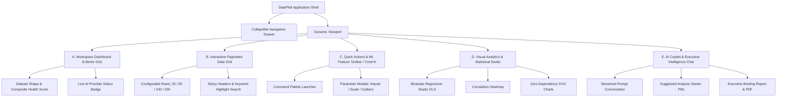

# DataPilot — UI/UX Design & Architecture Guidelines

This document outlines the design philosophy, component architecture, design token system, and user experience strategy for **DataPilot**, an enterprise-grade AI-powered data management, cleaning, and analytics platform.

---

## 1. Design Philosophy & Aesthetic

DataPilot bridges the gap between raw statistical data processing and conversational artificial intelligence. The interface must communicate **trust, precision, speed, and sophistication**.

```
┌────────────────────────────────────────────────────────────────────────┐
│                        DataPilot Design Principles                     │
├─────────────────────┬───────────────────────┬──────────────────────────┤
│ 1. Precision        │ 2. Velocity           │ 3. Cognitive Clarity     │
│ Dense, tabular      │ Instant feedback,     │ Clean separation between │
│ numerical views     │ optimistic updates,   │ deterministic transforms │
│ with exact metrics  │ zero layout shift     │ and generative AI        │
└─────────────────────┴───────────────────────┴──────────────────────────┘
```

### Color Palette & Design Tokens

DataPilot uses a dual-mode semantic color system with crisp slate neutrals, tech-indigo brand accents, and emerald/amber indicators for analytical feedback:

| Token | Light Mode Value | Dark Mode Value | Usage / Intent |
|---|---|---|---|
| `bg-primary` | `#F8FAFC` (Slate 50) | `#0B0F17` (Deep Obsidian) | Canvas background |
| `bg-surface` | `#FFFFFF` (Pure White) | `#131B2E` (Charcoal Slate) | Cards, modals, grids |
| `border-subtle` | `#E2E8F0` (Slate 200) | `#1E293B` (Slate 800) | Borders, gridlines |
| `text-primary` | `#0F172A` (Slate 900) | `#F8FAFC` (Slate 50) | Primary headers, data values |
| `text-muted` | `#64748B` (Slate 500) | `#94A3B8` (Slate 400) | Secondary metadata, labels |
| `brand-indigo` | `#4F46E5` (Indigo 600) | `#6366F1` (Indigo 500) | Primary brand accent & active states |
| `brand-blue` | `#2563EB` (Blue 600) | `#3B82F6` (Blue 500) | Action buttons, regression overlays |
| `status-success` | `#059669` (Emerald 600) | `#10B981` (Emerald 500) | Cleaned rows, healthy datasets |
| `status-warning` | `#D97706` (Amber 600) | `#F59E0B` (Amber 500) | Missing values, outliers |
| `status-danger` | `#DC2626` (Red 600) | `#EF4444` (Red 500) | File errors, deleted rows |

### Typography

- **Primary Interface**: [Inter](https://fonts.google.com/specimen/Inter) / [Plus Jakarta Sans](https://fonts.google.com/specimen/Plus+Jakarta+Sans)
  - Configured for high legibility in dense data tables, micro-labels (`text-[10px]`, `text-xs`), and analytical prose.
- **Data & Numeric Displays**: [JetBrains Mono](https://www.jetbrains.com/lp/mono/) / Tabular Figures (`font-mono font-medium`)
  - Ensures numerical alignment across table columns, $R^2$ metrics, row indices, and status chips.

### Visual Feedback & Micro-Interactions

- **Loading States**: Shimmer skeletons for table loading, animated pulse dots for AI inference, and indeterminate progress bars for large file parsing.
- **Atomic Transformation Feedback**: Toast notifications upon completion of atomic actions (`dedup`, `trim`, `fill`, `impute`, `clip`), highlighting the exact count of rows/cells altered.
- **Hover Micro-glow**: Smooth subtle elevation (`hover-glow`) with brand-tinted drop shadows on interactive Bento cards.

---

## 2. Core UI Framework Recommendation

DataPilot utilizes **Tailwind CSS** paired with **shadcn/ui** patterns (built on Radix UI primitives).

### Architectural Rationale

1. **Full Source Ownership**:
   - Component primitives reside directly in `src/components/ui/`, granting 100% control over cell rendering, virtualized scrolling, and inline mutation behaviors.
2. **Zero Heavy Dependencies**:
   - Eliminates bulky CSS-in-JS runtimes (Emotion, styled-components) that introduce overhead during large table repaints. Custom zero-dependency SVG charts ensure bundle size remains under 100 KB gzipped.
3. **Native Accessibility (a11y)**:
   - Radix primitives supply out-of-the-box keyboard navigation, screen-reader labels (`aria-expanded`, `aria-selected`), and focus traps for enterprise compliance.

---

## 3. Key Interface Modules



### Module A: Workspace Dashboard & Bento Grid

- **Overview Metrics**:
  - High-impact Bento cards displaying:
    - **Dataset Shape**: Exact dimensions ($N \text{ rows} \times M \text{ columns}$).
    - **Missing Value Percentage**: Aggregated null ratio across the dataset.
    - **Data Health Score**: Composite quality index (0–100%) factoring in completeness, uniqueness, and column naming standard.
- **Quick Status Indicators**:
  - Live status indicator displaying current AI provider configuration:
    - **Local Ollama**: `🟢 Qwen 3.5 Local (Port 11434) — Offline & Private`
    - **Cloud Providers**: `🔵 Anthropic Claude / OpenAI GPT / Google Gemini — Active`

### Module B: Interactive Paginated Data Grid

- **Dense Data Inspection**:
  - Border-aligned table rows with alternating hover highlighting (`hover:bg-blue-50/25`).
  - Configurable page sizes: **25, 50, 100, 200 rows per page**.
- **Sticky Headers**:
  - Persistent column headers during vertical scrolling with frosted backdrop blur (`sticky top-0 bg-slate-100/90 backdrop-blur-sm`).
- **Inline Search & Keyword Highlighting**:
  - Real-time text filtering across records with instant visual keyword highlighting within matching table cells.

### Module C: Quick Actions & ML Feature Engineering Toolbar

- **Command Palette (`Cmd + K` / `Ctrl + K`)**:
  - Fast keyboard-driven launcher modal allowing quick search and triggering of:
    - Data cleaning: Deduplicate, Trim Whitespace, Drop Empty Rows, Fill Nulls, Normalize Headers.
    - Feature engineering: Imputation (Mean/Median/Mode), Outlier Handling (Clip/Drop via IQR 1.5×), One-Hot Encoding, Feature Scaling (MinMax/Z-Score).
    - File operations: Export Cleaned CSV, Export Excel Workbook with Native Charts.
- **Parameter Modals**:
  - Contextual modal drawers and inline parameter pickers with sensible defaults when targeting specific columns.

### Module D: Visual Analytics & Statistical Studio

- **Bivariate Regression Studio**:
  - Interactive scatter plots overlaid with Ordinary Least Squares (OLS) trendline.
  - Live metric chips: **$R^2$ (Coefficient of Determination)**, **Slope**, **Intercept**, and **Sample Count ($N$)**.
- **Pearson Correlation Heatmap**:
  - Color-graded matrix view spanning $+1.0$ (deep indigo) to $-1.0$ (crimson/amber), with dynamic tooltips on cell hover.
- **Zero-Dependency SVG Charts**:
  - Pure SVG bar charts, line graphs, and donut charts with custom hover tooltips and dynamic color sequencing.

### Module E: AI Copilot & Executive Intelligence Chat

- **Conversational Interface**:
  - Clean message bubbles separating user questions from AI streaming answers with markdown formatting.
- **Suggested Prompt Pills**:
  - Clickable starter chips (*"Summarize dataset"*, *"Find outliers in numeric columns"*, *"Identify data quality issues"*, *"What columns have missing values?"*).
- **Executive Report View**:
  - Structured, printer-friendly briefing layout partitioned into:
    1. Executive Summary & Data Quality Rating
    2. Data Hygiene & Missing Value Analysis
    3. Key Statistical Insights & Correlation Trends
    4. Strategic Machine Learning & Business Recommendations

---

## 4. Accessibility & Responsive Design

- **Desktop-First Optimization**: Tailored for data analysts and data scientists operating on wide desktop/laptop screens ($1280\text{px}+$).
- **Collapsible Navigation Drawer**: Left-hand navigation sidebar with 1-click collapse/expand (`w-56` down to `w-16`), expanding available width for wide data grids and analytical heatmaps.
- **Dark Mode Compatibility**: Tokenized CSS variables enabling fluid transitions between clean off-white analytics workspaces and low-strain dark rooms.
